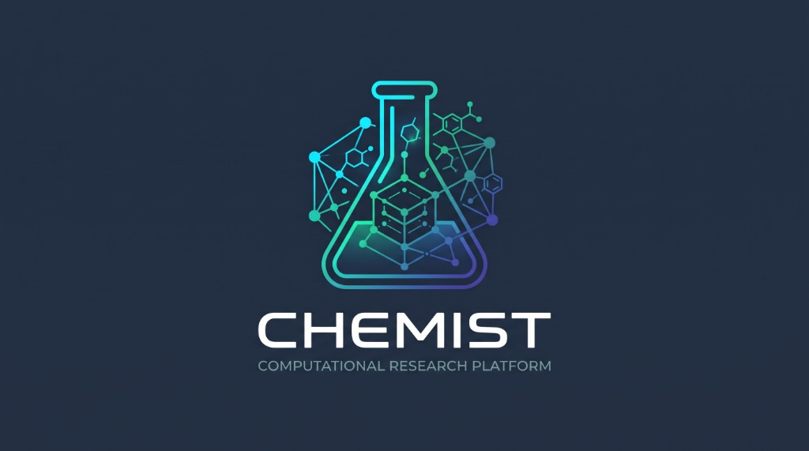
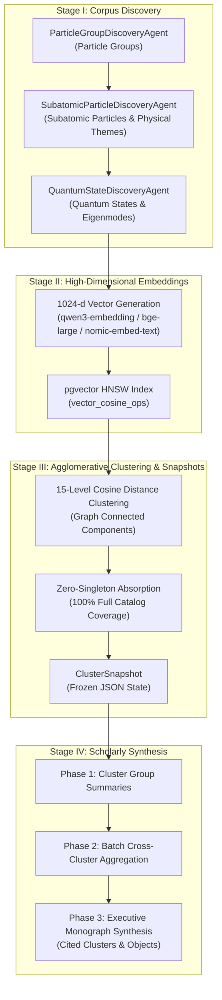

<p align="center">
  
</p>

# Physicist: A Computational Laboratory for Comparative Particle Physics, Subatomic Particles, and Quantum State Manifolds

[](https://www.ruby-lang.org/)
[](https://rubyonrails.org)
[](https://www.postgresql.org/)
[](https://github.com/pgvector/pgvector)
[](https://ollama.com)
[](https://github.com/flavorjones/ruby-llm)
[](https://sidekiq.org)
[](https://tailwindcss.com)
[](https://hotwired.dev)
[](LICENSE)

**Physicist** is an open-source computational research platform and quantitative analytical laboratory designed for **theoretical physicists**, **high-energy phenomenologists**, **quantum information scientists**, and **condensed matter researchers**. It enables physicists to systematically map, cluster, and synthesize physical archetypes, gauge invariants, spin-statistics, and symmetry manifolds across particle groups, subatomic particles, and quantum states using **1024-dimensional semantic vector embeddings (`pgvector`)**, **graph-theoretic connected components**, and **multi-stage AI synthesis pipelines**.

---

## Abstract & Scholarly Vision

Modern fundamental and condensed matter physics spans an enormous spectrum of empirical entities: Standard Model leptons, quarks, and gauge/scalar bosons; composite hadrons and exotic tetraquarks/pentaquarks; condensed-matter quasiparticles (phonons, Cooper pairs, anyons, skyrmions); and beyond-Standard-Model candidates (neutralinos, axions, sterile neutrinos). How can theorists and researchers discover systemic archetypal symmetries, dualities, and conservation analogies across disparate energy scales without losing the rigorous mathematical attributes of each state?

Physicist operationalizes comparative particle physics within a transparent, reproducible, locally hosted computational laboratory:

1. **Multi-Tier Physics Architecture**:
   - **Particle Groups (`ParticleGroup`)**: Major taxonomic families, structural sectors, and supermultiplets (e.g., Quarks, Leptons, Gauge Bosons, Baryons, Mesons, Condensed Matter Quasiparticles, BSM Candidates).
   - **Subatomic Particles (`SubatomicParticle`)**: Individual elementary particles, composite hadrons, and quasiparticle excitations (`belongs_to :particle_group`).
   - **Quantum States (`QuantumState`)**: Eigenstates, spin/polarization projections, helicity/chirality modes, color states, and coherent manifolds (`belongs_to :subatomic_particle`).
2. **High-Dimensional Semantic Manifold**: Every subatomic particle and quantum state profile is projected into a **1024-dimensional vector space** indexed via PostgreSQL `pgvector` HNSW (`vector_cosine_ops`), enabling empirical measurement of physical and symmetry proximity.
3. **Multi-Granularity Empirical Clustering & Snapshotting**: Researchers interactively tune cosine distance thresholds across **15 granularity levels** (from tight counterpart twins at *Level 1, $\le 0.16$* to zero-singleton **100% Full Catalog Coverage** at *Level 15* via nearest-cluster singleton absorption) and freeze states into immutable **Cluster Snapshots**.
4. **Map-Reduce & Hierarchical Deep Synthesis Reports**: Rather than shallow single-prompt summaries, Physicist executes a **2-Phase Map-Reduce** or **3-Phase Hierarchical Deep Synthesis** workflow over saved snapshots, inspecting every cluster through the researcher's specific physical inquiry and grounding every finding in cited cluster numbers, subatomic particles, and quantum states.

---

## 3-Tier Domain Mapping

| Tier | Domain Entity | Database Model | Table Name | Key Associations |
|------|---------------|----------------|------------|------------------|
| **Tier 1** | Particle Groups | `ParticleGroup` | `particle_groups` | `has_many :subatomic_particles`, `has_many :quantum_states, through: :subatomic_particles` |
| **Tier 2** | Subatomic Particles | `SubatomicParticle` | `subatomic_particles` | `belongs_to :particle_group`, `has_many :quantum_states`, `embeddable` |
| **Tier 3** | Quantum States | `QuantumState` | `quantum_states` | `belongs_to :subatomic_particle`, `has_one :particle_group, through: :subatomic_particle`, `embeddable` |

---

## End-to-End Empirical Research Pipeline



---

## Installation & Local Laboratory Setup

### Prerequisites

- **Ruby 3.4+**
- **PostgreSQL 16+** with `pgvector` extension installed (`CREATE EXTENSION IF NOT EXISTS vector;`)
- **Ollama** running locally on `http://localhost:11434` with an LLM and embedding model (e.g. `qwen2.5:32b`, `qwen3-embedding:0.6b` / `bge-large`)
- **Redis** running locally (for background job processing via Sidekiq)

### Setup

```bash
# Clone the repository
git clone https://github.com/leouofa/physicist.git
cd physicist

# Install dependencies
bundle install

# Prepare database (creates physicist_development and physicist_test, runs migrations)
bin/rails db:prepare

# Run test suite (185 tests, 100% passing)
bundle exec rails test

# Start the local development server (web + background worker)
bin/dev
```

Visit `http://localhost:3000` to access the interactive web interface.

---

## Programmatic REST API (`/api/v1`) & OpenAPI 3.1 Spec

Physicist provides a full-featured REST API under `/api/v1` returning JSON responses adhering to the `{ "data": ... }` envelope standard.

- Interactive OpenAPI 3.1 schema: `GET /api/v1/openapi.json`
- Full API documentation: see [docs/api.md](file:///Users/leonid/src/physicist/docs/api.md)

### Key Endpoints

- `GET /api/v1/particle_groups`: List particle groups
- `GET /api/v1/subatomic_particles`: List subatomic particles with optional filtering by `particle_group_id`, `theme`, or `q`
- `GET /api/v1/subatomic_particles/:id/neighbors`: Find nearest cosine-distance particle neighbors
- `GET /api/v1/quantum_states`: List quantum states with pagination
- `GET /api/v1/quantum_states/:id/neighbors`: Find nearest quantum state counterparts
- `GET /api/v1/clusters?target_type=SubatomicParticle&level=5`: Interactive agglomerative clustering
- `POST /api/v1/clusters/snapshot`: Freeze an empirical cluster snapshot
- `POST /api/v1/cluster_reports`: Synthesize an AI-grounded Map-Reduce or Deep Synthesis report

---

## Open Science, Reproducibility, & Testing

Physicist is designed for open, reproducible science:

- **100% Local Inference**: Zero proprietary API lock-in.
- **Deterministic Clustering**: Snapshot algorithms freeze graph-theoretic components alongside exact centroid distances.
- **Comprehensive Test Suite**: Model tests, agent tests, job tests, service tests, and API controller tests with 100% passing coverage:

```bash
bundle exec rails test
```

---

## License

This project is open-source software licensed under the [MIT License](LICENSE).
